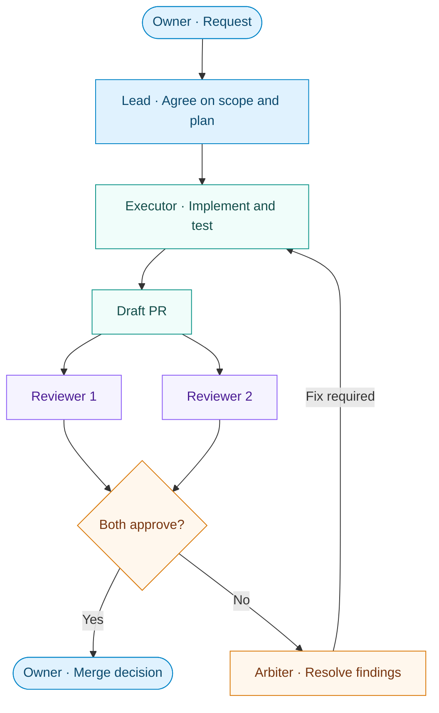

<h1 align="center">📘 Agent Playbook</h1>

<p align="center"><b>Roles, skills, and model sets for a team of coding agents.</b></p>

<p align="center">
  <a href="https://github.com/pogorelov17/agent-playbook/actions/workflows/check.yml"></a>
  
</p>

<p align="center">
  <a href="#-roles">Roles</a> · <a href="#️-model-sets">Model sets</a> · <a href="https://github.com/pogorelov17/t3-boat">T3 Boat ↗</a>
</p>



A **lead** talks to the human owner, clarifies the task, writes a spec and a plan, and dispatches **workers**. Each worker runs alone in its own isolated workspace, with no shared memory and no view of the others. This repository holds the instructions each of them reads. It is plain Markdown and JSON with no tie to any particular launcher: any tool can assemble one instruction file per role from it.

## 🧭 Roles

Each role lives in `roles/<role>/`: its `ROLE.md` and, where it has them, its own `skills/`. Files used by several roles live in `shared/`.

| | Role | Purpose | Instances |
| --- | --- | --- | :---: |
| 🧭 | `lead` | Talks to the owner; clarification gate, spec, plan, goal, dispatch, delivery. Never edits code, never merges. | 1 |
| 🛠️ | `executor` | Implements the plan test-first on a task branch and opens a draft pull request. | 1 |
| 🧐 | `reviewer` | Independently reviews one exact commit against the spec; returns `APPROVE` or `REQUEST_CHANGES`. | 2 |
| 🔎 | `scout` | Read-only code discovery; answers specific questions with paths and line numbers. | 1 |
| 📚 | `researcher` | Answers questions that need outside sources, with links, dates and confidence. | 1 |
| ⚖️ | `arbiter` | Settles disputed review claims by reproduction; cannot waive an approval. | 1 |

## 🔄 Delivery workflow

The executor opens a draft pull request; two reviewers review the same commit independently. When the verdicts conflict, or a finding is disputed (or after two failed repair rounds), the arbiter rules before any repair. An upheld finding leads to a repair by a fresh executor on the same branch and two fresh reviews of the new commit; if every finding behind a `REQUEST_CHANGES` is overturned, a replacement reviewer reviews the unchanged commit; a ruling that stays unresolved goes to the owner. Only the owner merges.

## 📦 How a bundle is assembled

`team.json` lists, per role, the ordered files of its **bundle**:

```json
"executor": {
  "stamp": "ROLE: executor",
  "instances": 1,
  "bundle": [
    "roles/executor/ROLE.md",
    "roles/executor/skills/following-plan.md",
    "roles/executor/skills/tests-first.md",
    "roles/executor/skills/handling-review.md",
    "shared/verification.md",
    "shared/debugging.md",
    "shared/reporting.md"
  ]
}
```

A bundle always starts with the role's `roles/<role>/ROLE.md`, then the role's own skills, then the shared files it needs. The instruction file for a role is these files concatenated in that order. A launcher loads it into the agent's context before the agent does anything. `instances: 2` means two agents with the same instructions run independently.

To see exactly what an agent receives:

```sh
python3 scripts/check.py --print executor > executor.md   # word count on stderr
```

Each file in the output is preceded by an HTML comment naming it, e.g. `<!-- file: roles/executor/ROLE.md -->`.

**For launchers and other consumers.** Read the bundle paths from `team.json` rather than hard-coding them. Since version 2.0.0 the role folders live in `roles/<role>/`; in 1.x they were top-level folders, so every bundle path `<role>/...` became `roles/<role>/...`. The cross-references inside the role texts and the `--print` file markers use the new paths; `shared/`, `models/`, the `team.json` format (schema 1), the bundle order and the `--print` interface are unchanged.

## 📜 The `ROLE.md` contract

Every `ROLE.md` has exactly these headings, in this order: `# <Role name>`, `## Who you are`, `## What you receive`, `## What you must deliver`, `## Rules`, `## You must not`, `## Report`, and no other heading of any level. Inside a section, structure with bold lead-in labels or numbered paragraphs. Skills and shared files may use sub-headings.

**The contract is about raw lines.** Agents read the raw text of their instruction file; nothing renders it. So the check works on raw lines and does not render or interpret Markdown. A *line* is what you get by splitting the file on `\n` only (after turning `\r\n` and `\r` into `\n`); a *blank* line is empty or ASCII spaces only. Each of these is an error, reported with file and line:

1. **Characters.** Any character other than `\n` and printable ASCII (0x20-0x7E): tab, other control characters, non-breaking space, byte-order mark, typographic quotes, dashes and arrows, any non-ASCII letter. The message names the code point.
2. **Hash lines.** Any line whose first non-space character is `#`, or whose first non-space characters are a list marker (`-`, `*`, `+`, or digits followed by `.` or `)`) followed by spaces and then `#`, unless it is one of the seven required heading lines, exactly, at column 0, in order, each once. This applies everywhere, inside fenced code too.
3. **Fences.** A fence line (first non-space characters three or more backticks or tildes) that does not start at column 0 or follows a list marker; a fence that is not closed by a fence of the same character, at least as long, before the end of the file.
4. **Angle brackets.** A line whose first non-space character is `<` (no raw HTML).
5. **Comments, quotes, setext underlines, indentation.** `<!--` anywhere; a block-quoted line (optional spaces, then `>`); a line that is one or more `=` and nothing else, or three or more `-` and nothing else directly after a non-blank line (put a blank line before a `---` thematic break); a line indented by four or more spaces outside fenced code.
6. **Required lines.** The ban, the first-line instruction and the stamp (below) are compared as whole raw lines and must be outside fenced code.

Every role except `lead` states, in its `ROLE.md`: the ban on starting other agents, the duty to read and follow the project's own instruction file (`AGENTS.md` or `CLAUDE.md`), and its report stamp (`ROLE: <role>`), which must be the first line of every report.

The ban is one canonical sentence (`AGENT_BAN` in `scripts/check.py`). One line outside fenced code must be exactly this sentence, optionally after a `- ` or `N. ` list marker (`N`: one to nine ASCII digits), with nothing else on the line; further text goes on the next line:

```text
You never start, spawn, schedule or delegate to other agents, sub-agents, threads, workflows or new machines, even when a tool or a built-in skill offers it.
```

The first-line instruction is also one canonical sentence (`FIRST_LINE_RULE`). Inside the `## Report` section, one line must be exactly this sentence, and the next non-blank line must be exactly the stamp `ROLE: <role>`, with no leading or trailing whitespace:

```text
The first line of every report is exactly:

ROLE: <role>
```

## ✅ Validating

```sh
python3 scripts/check.py                    # exits 0 when the playbook is valid
python3 -m unittest discover -s tests       # tests for the validator
```

`check.py` (Python 3.10+, standard library only) checks `team.json` and every model set against their format and `model_rules`; that every bundle path is canonical, exists inside `roles/<role>/` or `shared/` and passes through no symbolic link; that every role folder sits in `roles/` and is declared; that no Markdown file there or in `shared/` is unbundled; every `ROLE.md` against the contract above; and that no text uses the launcher-specific words in `FORBIDDEN`. It guards this repository against accidental damage; it is not a general Markdown linter, and reviewers still read the text. CI (`.github/workflows/check.yml`) runs both commands on every pull request and on pushes to `main`.

## 🛠️ Changing or adding a role

To change a role, edit its `roles/<role>/ROLE.md` or skills and run `python3 scripts/check.py`. Keep the required headings. Write for an agent that knows nothing else: imperative, specific, each non-obvious rule with a one-line reason.

To add a skill, create `roles/<role>/skills/<name>.md` (or `shared/<name>.md`) and add it to the bundle of every role that needs it in `team.json`. An unbundled Markdown file fails the check as an orphan, and so does every Markdown file of a role folder that is not in `team.json`.

To add a role:

1. Create `roles/<role>/ROLE.md` with the seven required headings; the title is the role name (`# Release Manager` for `release-manager`).
2. Unless it is the lead, include the common worker rules (copy them from an existing worker role), with the agent-ban line, and put the first-line instruction and the stamp line `ROLE: <role>` in the `## Report` section.
3. Add the role to `team.json` with its stamp, instances and bundle (always including `shared/reporting.md` and `shared/verification.md`).
4. Add a model for it to every file in `models/`, and add it to `model_rules` if it must run on a model different from another role.
5. Update the approved-team assertions in `tests/` (the repository test pins the six roles).
6. Run the validator and the tests.

## 🎛️ Model sets

A model set picks a provider (`codex` or `claude`), a model family and an effort for each role; a launcher resolves the family to its newest release. A role with two instances has a list of two entries. The table shows each entry's family ID and effort; the provider is in the set file.

| Role | `codex-only` | `claude-only` | `codex+claude` |
| --- | --- | --- | --- |
| 🧭 lead | `astra` high | `opus` high | `astra` high |
| 🛠️ executor | `sol` medium | `opus` high | `opus` high |
| 🧐 reviewer 1 | `astra` high | `fable` high | `fable` high |
| 🧐 reviewer 2 | `sol` high | `sonnet` high | `astra` high |
| 🔎 scout | `luna` low | `haiku` medium | `haiku` medium |
| 📚 researcher | `sol` high | `opus` high | `sol` high |
| ⚖️ arbiter | `astra` xhigh | `fable` high | `astra` xhigh |

`team.json` declares the rule that reviewers and the arbiter must run on a model (provider and family) different from the executor's. The lead receives the assignment as an input and also checks it against every model that actually authored commits on the pull request, across all rounds. A set may declare an exception to a rule, with a reason. `codex-only` declares one: reviewer #2 shares the executor's family (`sol`), because that provider set has too few distinct families; it runs at a different effort in its own isolated workspace.

A model set file looks like this (abridged):

```json
{
  "schema": 1,
  "name": "codex-only",
  "roles": {
    "executor": {"provider": "codex", "family": "sol", "effort": "medium"},
    "reviewer": [
      {"provider": "codex", "family": "astra", "effort": "high"},
      {"provider": "codex", "family": "sol", "effort": "high"}
    ]
  },
  "exceptions": [
    {"role": "reviewer", "instance": 2, "must_differ_from": "executor", "reason": "..."}
  ]
}
```

An exception that no longer matches a violation fails the check, so stale exceptions do not linger.

## License

MIT. See [LICENSE](LICENSE).
